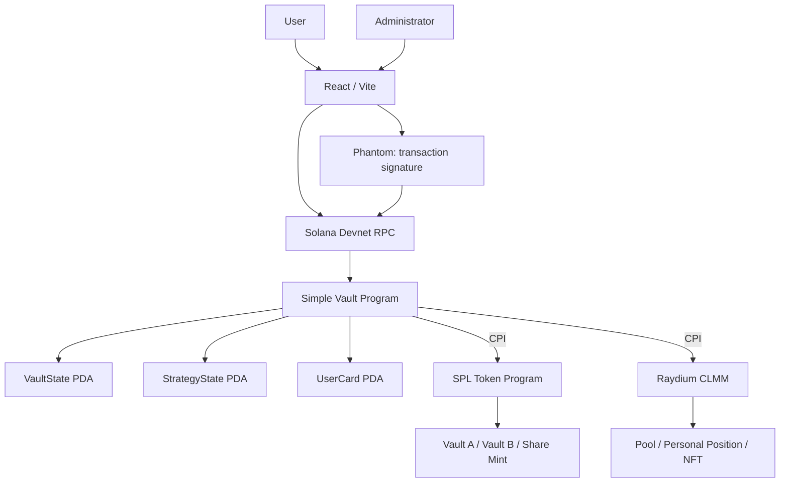

# Simple Vault — практика Anchor (Solana Devnet)

**Учебный проект на Rust, Solana и Anchor Framework 0.31.1.**

Simple Vault — смарт-контракт для хранилища SPL-токенов (Vault): персональные карточки пользователей через PDA, депозиты и share-токены.

- Неделя 8 — каркас vault, карточки пользователей, пауза.
- Неделя 9 — депозит и share-токены.
- Неделя 10 — вывод из vault: сжигание share-токенов и возврат токенов через CPI.
- Неделя 11 — свои тестовые токены и свой CLMM-пул Raydium в devnet (скриптами, контракт не менялся).
- Неделя 12 — интеграция Raydium CLMM через CPI, второе токен-хранилище, обмен токенов, защита от slippage и обратный обмен с восстановлением учёта vault.

- Неделя 13 — LP-позиция, комиссии, ребалансировка и синхронизация.
- Неделя 14 — веб-интерфейс Liquidity Vault.

## 1. Инструкции контракта

| Инструкция | Назначение | Кто вызывает |
|---|---|---|
| `initialize_vault` | Создаёт VaultState, токен-аккаунт хранилища и share mint | администратор |
| `create_user_card` | Создаёт персональную карточку пользователя | пользователь |
| `close_user_card` | Закрывает пустую карточку и возвращает ренту | владелец карточки |
| `set_paused` | Включает или выключает паузу | администратор |
| `deposit(amount)` | Переводит токены в vault и выпускает share-токены | пользователь |
| `withdraw(shares)` | Сжигает share-токены и возвращает пользователю его долю токенов | пользователь |
| `initialize_strategy` | Создаёт второе токен-хранилище для Token B | администратор |
| `swap` | Выполняет обмен токенов A ↔ B через Raydium CLMM CPI | администратор |
| `initialize_position_strategy` | Создаёт StrategyState | администратор |
| `open_position` | Открывает LP-позицию | администратор |
| `collect_fees` | Собирает комиссии | администратор |
| `close_position` | Закрывает LP-позицию | администратор |
| `sync_vault` | Восстанавливает учёт | администратор |

## 2. Схема аккаунтов

| Аккаунт | Seeds | Владелец / authority | Что хранит |
|---|---|---|---|
| `vault_state` | `["vault", token_mint]` | программа | admin, token_mint, адреса аккаунтов, `total_tokens`, `total_shares`, bump, `paused` |
| `vault_token_account` | `["vault_tokens", token_mint]` | PDA `vault_state` | сами токены, внесённые пользователями |
| `share_mint` | `["share_mint", token_mint]` | PDA `vault_state` | mint share-токенов (6 decimals); выпускать может только программа |
| `user_card` | `["user_card", vault_state, user]` | программа | vault, owner, `deposited`, `shares`, bump, `created_at` |

| `vault_b` | `["vault_tokens_b", vault_state]` | SPL Token Program / PDA vault_state | Token B |
| `strategy_state` | `["position_strategy", vault_state]` | программа | состояние LP-позиции и синхронизации |

Карточку пользователя всегда можно найти по адресу: он вычисляется из адреса vault и адреса пользователя, список пользователей хранить не нужно.

## 3. Депозит (неделя 9)

Пользователь вносит `amount` токенов и получает share-токены: «квитанцию» с его долей в vault.

Шаги внутри `deposit`:

1. Проверки: `amount > 0`, vault не на паузе.
2. Расчёт shares.
3. Перевод токенов пользователя в `vault_token_account` (CPI в Token Program, подписывает **пользователь**).
4. Выпуск shares на share-аккаунт пользователя (CPI в Token Program, подписывает **PDA vault**).
5. Обновление учёта: `total_tokens`, `total_shares` в vault, `deposited`, `shares` в карточке.

Формула:

```
Первый депозит:       shares = amount
Последующие депозиты: shares = amount × total_shares ÷ total_tokens
```

Пример: A вносит 100 → 100 shares. Затем B вносит 50 → 50 shares. В vault 150 токенов и 150 shares, доли: A — 2/3, B — 1/3. Если vault заработает и токенов станет больше, чем shares, поздний вкладчик получит shares меньше, чем внёс токенов: каждый share стал дороже, и доход ранних вкладчиков не достаётся новичкам.

Ошибки: `ZeroAmount`, `SharesTooSmall`, `MathOverflow`, `VaultPaused`, а также ошибка Anchor, если у пользователя нет карточки.

Дополнительные решения:

- Во время паузы депозиты запрещены (как и создание карточек).
- Карточку с депозитом или shares закрыть нельзя (`CardNotEmpty`), чтобы не потерять учёт доли. Пустую карточку можно закрыть даже на паузе.

## 4. Вывод (неделя 10)

Пользователь возвращает `shares` share-токенов и забирает свою долю токенов.

Формула (округление **вниз**, чтобы vault не отдал больше положенного):

```
tokens = shares × total_tokens ÷ total_shares
```

Шаги внутри `withdraw`:

1. Проверки: `shares > 0`, `shares <= user_card.shares`, итоговая сумма `tokens > 0`.
2. Расчёт `tokens` и части `deposited`, которая списывается с карточки (пропорционально выводимым shares).
3. **CPI `burn`** в Token Program: сжигаются share-токены пользователя. Подписывает **пользователь**.
4. **CPI `transfer`** в Token Program: токены из `vault_token_account` переводятся пользователю. Подписывает **программа от имени PDA `vault_state`** (`invoke_signed`: seeds `["vault", token_mint, bump]`).
5. Обновление учёта: `total_tokens` и `total_shares` уменьшаются, `shares` и `deposited` в карточке тоже.

Пример: в vault 140 токенов и 140 shares, пользователь возвращает 40 shares → получает 40 × 140 ÷ 140 = 40 токенов. Если бы vault заработал и в нём стало 154 токена при тех же 140 shares, то за 40 shares пользователь получил бы 40 × 154 ÷ 140 = 44 токена.

Решения:

- **Вывод разрешён и на паузе.** Пауза останавливает новые депозиты и карточки, но не должна запирать деньги пользователей.
- Администратор не может забрать токены vault своей подписью: хранилищем распоряжается только PDA, а подписать за PDA может только программа внутри `withdraw` (и других инструкций программы).
- `deposited` списывается пропорционально. Если вывести все shares, `deposited` и `shares` обнуляются, и карточку можно закрыть (`close_user_card`).
- Ограничение учебной версии: лимит вывода считается по `shares` на карточке. Share-токены обычные, их можно передать другому человеку, но вывести по ним получится только при совпадении с учётом карточки.

Ошибки: `ZeroAmount`, `InsufficientShares`, `WithdrawTooSmall`, `MathOverflow`, а также ошибка Anchor, если нет карточки или она чужая.

### Какие CPI видны в транзакции вывода

В Solana Explorer в транзакции вывода (Instruction: Withdraw) видны два вызова
Token Program (Inner Instructions), сделанные из программы Simple Vault:

1. `Burn` — сжигание 30 share-токенов (authority — пользователь, он подписывает транзакцию).
2. `Transfer` — перевод 30 токенов из хранилища vault пользователю
   (authority — PDA `vault_state`, подписывает программа через `invoke_signed`).

Лог программы: `Withdraw: 30000000 shares -> 30000000 tokens (total_tokens = 100000000, total_shares = 100000000)`.

Транзакция вывода: https://explorer.solana.com/tx/3qkLB3QH96L4PU5jT3qkRuR1iGfYHq2jpjXNT66wQwCi3WA3Kf7N9wH4Er8EEkWgCBzJG9ZEKvs3tdrqF6Vdef57?cluster=devnet

## 5. Свои токены и CLMM-пул Raydium (неделя 11)

Контракт `simple_vault` на этой неделе **не менялся**. Нужно было подготовить площадку для недель 12–13: свои токены и свой пул с ликвидностью, в котором vault будет обменивать токены и открывать позиции. Всё сделано скриптами из папки `scripts/` (запуск через `tsx`, сеть devnet).

| Шаг | Команда | Что делает |
|---|---|---|
| 1 | `yarn week11:tokens` | создаёт два тестовых токена (6 decimals) и выпускает по 1 000 000 каждого на кошелёк |
| 2 | `yarn week11:pool` | создаёт CLMM-пул Raydium из этих токенов с начальной ценой 1 |
| 3 | `yarn week11:position` | вручную, со своего кошелька, открывает одну позицию вокруг текущей цены |

Файлы: `scripts/raydium-config.ts` (общие настройки и проверка, что RPC именно devnet), `scripts/create-tokens.ts`, `scripts/create-clmm-pool.ts`, `scripts/open-position.ts`. Все адреса сохранены в `week11-addresses.json` (только публичные адреса, ключей там нет). Версия `@raydium-io/raydium-sdk-v2` указана в `package.json`.

### Адреса в devnet

| Что | Адрес |
|---|---|
| Токен A | [`CCRTcoXihFnKNXepJk2eCA87qJNz8HWSgVMV19ctT1r`](https://explorer.solana.com/address/CCRTcoXihFnKNXepJk2eCA87qJNz8HWSgVMV19ctT1r?cluster=devnet) |
| Токен B | [`A2dsMy371WJkZyuVBWUg9BscPz9SRcDG8f77C5YUDXX5`](https://explorer.solana.com/address/A2dsMy371WJkZyuVBWUg9BscPz9SRcDG8f77C5YUDXX5?cluster=devnet) |
| Программа CLMM Raydium (devnet) | [`DRayAUgENGQBKVaX8owNhgzkEDyoHTGVEGHVJT1E9pfH`](https://explorer.solana.com/address/DRayAUgENGQBKVaX8owNhgzkEDyoHTGVEGHVJT1E9pfH?cluster=devnet) |
| Конфиг комиссий (amm config) | [`CD4aJtX11cqTCAc83nxSPkkh5JW2yjD6uwHeovjqQ1qu`](https://explorer.solana.com/address/CD4aJtX11cqTCAc83nxSPkkh5JW2yjD6uwHeovjqQ1qu?cluster=devnet) |
| **Пул** | [`4tAPx2mdfGQCWmx3EV4qCkbWK52PbzWVNFpxLkfs25nP`](https://explorer.solana.com/address/4tAPx2mdfGQCWmx3EV4qCkbWK52PbzWVNFpxLkfs25nP?cluster=devnet) |
| **Позиция (NFT)** | [`FiiVsEg2qKrsFDiFdsAv6KFnbKnDE4vGCECbbtN7Jj6J`](https://explorer.solana.com/address/FiiVsEg2qKrsFDiFdsAv6KFnbKnDE4vGCECbbtN7Jj6J?cluster=devnet) |
| Транзакция создания пула | [ссылка](https://explorer.solana.com/tx/szmL6EQM3DgZP83qZrSku2r5KnYVKUq6RNEx5xAq65uanvJSgUEAQiNeNYgdWjqD8G7TFLXhPsLAjpgbpd1mmpP?cluster=devnet) |
| Транзакция открытия позиции | [ссылка](https://explorer.solana.com/tx/3AxxHDnrvK77R6NwCVCTmndDBX4HPwKEsyuJoP2ub69kcoiZUtVVPdESqZjiuMsSH1N4GQNhPVZdF7w5W5dnpCdk?cluster=devnet) |

Кошелёк, с которого всё сделано: `mXNWnxD3gdAiWqsPFF1Zb9V4yZtJW1zMbr7FRgXRxJb` (devnet). NFT позиции лежит у него: тот, кто владеет NFT, владеет позицией.

### Параметры пула и позиции

- **Текущая цена пула:** 1 (1 токен A = 1 токен B), это начальная цена при создании пула. Открытие позиции внутри диапазона цену не двигает.
- **Комиссия пула:** 0,25% с каждого обмена (`tradeFeeRate` 2500), шаг цены `tickSpacing` = 60.
- **Выбранный диапазон:** от 0,9 до 1,1, то есть ±10% от текущей цены. После округления до шага тиков (кратных 60) реальные границы: тики −1080 … 960, то есть цена примерно 0,8976 … 1,1008.
- **Внесено в позицию:** около 10 000 токенов первого токена пула (порядок токенов в пуле задаёт Raydium по сортировке адресов) и около 11 100–11 200 второго. Точные суммы видны в транзакции открытия позиции в Explorer.

### Почему выбран именно такой диапазон

Пара токенов у нас учебная, обе стороны стоят одинаково (цена 1), поэтому логично сделать диапазон симметричным вокруг текущей цены. Ширину ±10% я взял как «обычное колебание цены за период»: это правило из методички (отступить от цены вверх и вниз на обычное колебание, например 5–10%).

Что это даёт и чем рискуем:

- **Узкий диапазон зарабатывает больше.** В обычном пуле деньги размазаны по всем ценам от нуля до бесконечности, и почти все лежат без дела. Здесь те же деньги работают только рядом с текущей ценой, поэтому на каждый обмен в этом коридоре позиция получает большую долю комиссий.
- **Но за это приходится следить.** Если цена выйдет за границы диапазона (ниже 0,8976 или выше 1,1008), позиция перестанет участвовать в обменах и не будет зарабатывать комиссии, пока цена не вернётся или диапазон не передвинут (это называется ребалансировка). Чем уже диапазон, тем чаще это случается.
- **Соотношение токенов в позиции зависит от цены.** Пока цена внутри диапазона, в позиции есть оба токена. Если цена уйдёт выше верхней границы, позиция превратится целиком во второй токен, если ниже нижней, то целиком в первый.
- **Почему не уже.** Шаг цены в пуле 60 тиков (около 0,6%), и очень узкий диапазон при учебных тестах слишком часто выходил бы из рабочей зоны. ±10% — разумный компромисс между доходом и вниманием.

На неделях 12–13 vault будет делать то же самое сам: обменивать токены в нужной пропорции и открывать/закрывать такие позиции через CPI.

## 6. Запуск

```bash
yarn install
anchor --version              # ожидается anchor-cli 0.31.1
solana config set --url devnet
solana balance                # нужны тестовые SOL (https://faucet.solana.com/)
anchor build
anchor deploy --provider.cluster devnet
yarn test
```

`yarn test` запускается с `--skip-deploy`, поэтому после изменений в коде сначала нужны `anchor build` и `anchor deploy`.

После `anchor build` и `anchor deploy` запустить тесты можно и напрямую, без `anchor test`:

```bash
ANCHOR_PROVIDER_URL=https://api.devnet.solana.com \
ANCHOR_WALLET=$HOME/.config/solana/id.json \
yarn run ts-mocha -p ./tsconfig.json -t 1000000 tests/vault.ts
```

Если ID в `declare_id!` не совпадает с ключом в `target/deploy`, выполнить `anchor keys sync` и пересобрать программу, иначе тесты упадут с ошибкой `DeclaredProgramIdMismatch` (4100).

Структура аккаунтов изменилась по сравнению с неделей 8, поэтому старые vault и карточки с devnet не подходят. Тесты каждый раз создают новый mint, а значит, новый vault.

## 7. Тесты (`tests/vault.ts`)

1. `initialize_vault` — vault создан, `paused = false`, `total_tokens = 0`, `total_shares = 0`.
2. `create_user_card` — карточки созданы, `created_at > 0`.
3. Повторное создание карточки отклоняется.
4. `set_paused` не-админом отклоняется.
5. Setup токен-аккаунтов.
6. Депозит A: 100 токенов → 100 shares.
7. Депозит B: 50 токенов → 50 shares, `total_tokens = total_shares = 150`.
8. Депозит без карточки отклоняется.
9. Депозит 0 отклоняется.
10. Администратор включает паузу.
11. Создание карточки на паузе отклоняется.
12. Депозит на паузе отклоняется.
13. Чужую карточку закрыть нельзя.
14. Карточку с депозитом закрыть нельзя.
15. Пустую карточку можно закрыть на паузе, рента возвращается.
16. Администратор снимает паузу.
17. После паузы карточка создаётся.
18. После паузы депозит работает.
19. Неделя 10: A возвращает 40 shares и получает 40 токенов, учёт в vault и карточке обновлён.
20. Вывод 0 отклоняется.
21. Вывод больше, чем есть на карточке, отклоняется.
22. По чужой карточке вывести нельзя.
23. На паузе вывод работает.
24. D выводит всё: карточка обнуляется и закрывается.


## 8. Адреса и ссылки

- Сеть: Solana Devnet
- Program ID: `AQ1t23jJHzxzT1YR1n5ygPeamaEjg3kEYG7tyitDyapm`
- Программа в Explorer: https://explorer.solana.com/address/AQ1t23jJHzxzT1YR1n5ygPeamaEjg3kEYG7tyitDyapm?cluster=devnet
- Транзакция деплоя: https://explorer.solana.com/tx/eKSH2eoHqVjrNN7vtjJ2LjYzNyCc6dfeF2yMesJEvnxs7QDR8SE4ZgQr3GRxTYJ6xaWKEDoUQThchEKfdLdJkrZ?cluster=devnet
- Репозиторий: https://github.com/feskyy/ITStartup_Solana
- **Транзакция депозита в Explorer:** https://explorer.solana.com/tx/23o4ZKvv4rZvzZKbL3btdHLpmeDQpkN7Vx5XJwzW5qX9btbjpnptnUkuYkopzkDoeLtKS9ALQWsKW3vhCi6xrTe2?cluster=devnet

- **Транзакция вывода в Explorer:** https://explorer.solana.com/tx/3qkLB3QH96L4PU5jT3qkRuR1iGfYHq2jpjXNT66wQwCi3WA3Kf7N9wH4Er8EEkWgCBzJG9ZEKvs3tdrqF6Vdef57?cluster=devnet

- Программы, которые участвуют в транзакции депозита: Simple Vault (`AQ1t23jJHzxzT1YR1n5ygPeamaEjg3kEYG7tyitDyapm`) вызывает Token Program (`transfer` — перевод токенов пользователя в vault, `mint_to` — выпуск share-токенов). 

## 9. Безопасность

- Токены vault лежат на PDA, у которого нет приватного ключа: ни администратор, ни кто-то другой не может забрать их своей подписью.
- Share-токены выпускает только программа (mint authority — PDA vault).
- Токены из vault переводятся через `withdraw` при погашении shares пользователя или через `swap` при выполнении стратегии Raydium CLMM.
- Инструкция `swap` предусматривает проверку полномочий администратора.
- Обмен выполняется через CPI с подписью PDA vault.
- Минимальное количество выходных токенов защищает vault от недопустимого результата обмена.
- При отклонении swap изменения состояния транзакции отменяются.
- Пока Vault B содержит токены стратегии, депозит и вывод временно заблокированы.
- После полного обратного обмена B → A внутренний учёт восстанавливается.
- Перевод токенов пользователя подписывает сам пользователь.
- Проверки seeds и bump, `has_one = admin` для паузы, ограничения владельца карточки.
- Арифметика через `checked_*` и `u128`, чтобы не было переполнения.
- Не публиковать в GitHub: `id.json`, `*-keypair.json`, seed-фразы.

## 10. Частые ошибки

| Ошибка | Причина | Решение |
|---|---|---|
| `Insufficient funds` | Мало тестовых SOL | Пополнить через faucet |
| `AccountNotInitialized` | Программа не развёрнута или нет карточки | `anchor build`, `anchor deploy`, затем `create_user_card` |
| `already in use` | Карточка уже существует | Ожидаемо: карточка одна на пользователя |
| `VaultPaused` | Включена пауза | Администратор вызывает `set_paused(false)` |
| `ZeroAmount` | `amount = 0` | Вносить сумму больше нуля |
| `SharesTooSmall` | Депозит слишком мал | Увеличить сумму |
| `CardNotEmpty` | На карточке есть депозит | Сначала вывести все shares через `withdraw` |
| `InsufficientShares` | Вывод больше, чем shares на карточке | Уменьшить сумму |
| `WithdrawTooSmall` | За эти shares получилось бы 0 токенов | Увеличить сумму |
| `429 Too Many Requests` | Лимит публичного RPC | Подождать: клиент сам повторяет запросы |
| `DeclaredProgramIdMismatch` (4100) | В задеплоенном бинарнике другой ID, чем адрес программы | `anchor keys sync`, `anchor build`, `anchor deploy` |
## Week 12 — Raydium CLMM swap (Devnet)

Реализация подготовлена для пула недели 11. `initialize_strategy` создаёт второй SPL token account с authority vault PDA. `swap` проверяет администратора, фиксированные адреса пула и программы, mint и authority хранилищ. CPI `swap_v2` подписывается seeds `vault`, mint A, bump. Клиент рассчитывает quote и минимум 99% от ожидаемого выхода. Обратный обмен B → A поддерживается.

Используется локальный ABI-адаптер `raydium_swap.rs` вместо прямой Rust-зависимости Raydium: официальный CPI example использует Anchor 0.29, проект — 0.31.1. Порядок аккаунтов и аргументов взят из официального `proxy_swap.rs`. Это отклонение от буквального требования подключить библиотеку; согласуйте с преподавателем. Существующая зависимость Raydium SDK V2 используется для quote.

Учебное ограничение: `total_tokens == u64::MAX` означает активную стратегию (не баланс). Депозиты и вывод блокируются до полного обратного обмена B → A; затем учёт синхронизируется с балансом A. Размер VaultState не изменён. Для недели 13 рекомендуется заменить sentinel отдельным состоянием стратегии и учитывать открытую LP-позицию. Не использовать в mainnet.

Фактические транзакции добавляются командой `yarn week12:report` после исполнения в Devnet. Ниже приведены сохранённые результаты тестирования.


<!-- WEEK12_EVIDENCE_START -->
### Week 12 — фактические результаты Devnet

- Vault: 8BhjDWjuCJ1XbMKssyjx59B53rufTZh99PQpHziDhZjG
- Token A storage: J2XXhFpWZG9p5NuUhg82AiLCuh9PYLtgT4AKGNsZEaPx
- Token B storage: HbkscEwZMdVzDsLYyU27FpAjmsuWLPQcs9FyqkXpySpD
- Успешный swap: https://explorer.solana.com/tx/4usG7Ckv1VkSY6z5DKnR3H2W5v4NPhufPtYngzT7PhDQWSeXbCGwARZFfSa5YEayeUjWfBCm1dp4DEzSAVcYQRk7?cluster=devnet
- Отклонённый swap (slippage): https://explorer.solana.com/tx/5hSJwYJeYj7xpDqzZ4J3LHewbAYtKUN3FmcpFA6A6dtsiEU4emyvN2CRMk4ChP3vw3zHL2hAeeNUhZ8f5a426Mrn?cluster=devnet
- Цена пула до: 1; после: 0.9999065130238968 (в порядке mintA/mintB Raydium).
- Балансы до (raw): A=100000000, B=0; после: A=90000000, B=9974533.
- Ожидаемый выход: 9974533; минимальный: 9874787 (raw).
- При отклонении балансы vault не изменились; комиссия сети может быть списана.
- Обратный обмен: https://explorer.solana.com/tx/4BxHNUPn4MJ6gi77kfmJ5bpdsSACTU8nu7Zu7HiBjxUSCCxCQik3mJGJ5iRxuYhiiB4qhw99erq69nfYoik6e8Ht?cluster=devnet

<!-- WEEK12_EVIDENCE_END -->

### Дополнительные результаты тестирования Week 12

Дата тестирования: 25 ноября 2026 года.

Сеть: Solana Devnet.

Версия Anchor: 0.31.1.

#### Результаты операций

Все значения токенов и shares в таблице приведены с учётом 6 decimals.

| Операция | Vault A | Vault B | Total Shares | Цена пула |
|---|---:|---:|---:|---:|
| Initialization | 0 | 0 | 0 | 1 |
| Deposit | 100 | 0 | 100 | 1 |
| Swap A → B | 90 | 9.974533 | 100 | 0.9999065130238968 |
| Rejected Swap | 90 | 9.974533 | 100 | 0.9999065130238968 |
| Reverse Swap B → A | 99.950062 | 0 | 100 | 0.9999997662640966 |
| Withdraw | 98.950562 | 0 | 99 | 0.9999997662640966 |

#### Проверка CPI

В логах успешной транзакции подтверждена следующая последовательность вызовов:

1. Simple Vault Program — invoke [1].
2. Raydium CLMM Program, инструкция SwapV2 — invoke [2].
3. SPL Token Program — invoke [3].

Обмен 10 Token A вернул 9.974533 Token B при минимально допустимом результате 9.874787 Token B.

Программа Simple Vault использовала 76 096 Compute Units, из которых 46 508 CU пришлось на вызов Raydium CLMM.

#### Проверка Slippage Protection

Для отрицательного теста использовался обмен 1 Token A с намеренно недостижимым минимальным выходом `u64::MAX`.

Raydium вернул ошибку:

- Error Code: TooLittleOutputReceived.
- Error Number: 6018.
- Custom Program Error: 0x1782.

После отклонения транзакции балансы обоих хранилищ и цена пула остались неизменными. Это подтверждает атомарность операции. Сетевая комиссия составила 0.000005 SOL.

#### Обратный обмен и восстановление учёта

Весь баланс Vault B (9.974533 Token B) был обменян обратно на 9.950062 Token A.

После обратного обмена:

- Vault A: 99.950062 Token A.
- Vault B: 0 Token B.
- Total Tokens: 99.950062.
- Total Shares: 100.
- Блокировка стратегии снята.

Совокупная потеря при двойном обмене составила 0.049938 Token A, или 0.049938% первоначального депозита.

#### Проверка Withdraw

После завершения стратегии выполнено погашение одной доли.

Пользователь получил 0.999500 Token A с учётом округления вниз.

Итоговое состояние хранилища:

- Total Tokens: 98.950562.
- Total Shares: 99.
- Vault B: 0.

Таким образом, возможность вывода средств после завершения стратегии подтверждена практической транзакцией.

#### Дополнительные транзакции Solana Explorer

- [Обновление программы Week 12](https://explorer.solana.com/tx/2tJYme9ue4E1Yh1jHhA8hp2y7yNe6zX1W915i8ya4PcyeWe3DgRJNVa2nrpmKcpCLs5kKF4QbEhdiL3k35ydBcrn?cluster=devnet)
- [Deposit 100 Token A](https://explorer.solana.com/tx/5FjFgt1wjgvrVrnsvam8KzAxytADFiLvr1FoJSnLRiAqbihsrbiuuwqH5urgjX75L6ewPfK4zSRjCxKStdr5TNCi?cluster=devnet)
- [Withdraw после завершения стратегии](https://explorer.solana.com/tx/2Gd1BtcZaVGZoFjwuLAr7b3WLEL5PsGkHGmfDr7fcHJWVtgVAPSbLPekXxHsk3qj2KaZVPQTnsdP8KPWomMQvaKW?cluster=devnet)

#### Ограничения учебной реализации

Для интеграции Raydium используется локальный ABI-адаптер `raydium_swap.rs`. Его работоспособность подтверждена транзакциями Devnet.

Для временной блокировки операций используется специальное значение `total_tokens = u64::MAX`. В дальнейшем необходимо выделить отдельное состояние стратегии и реализовать полноценный учёт стоимости активов.

Отдельный отрицательный тест вызова swap неавторизованным пользователем не проводился.

Реализация предназначена для учебного использования в Devnet и не рекомендуется для Mainnet без дополнительного тестирования и аудита безопасности.

#### Заключение

В рамках Week 12 реализован и практически проверен обмен токенов между хранилищами Simple Vault через Raydium CLMM CPI. Подтверждены успешный обмен, изменение цены пула, защита от недопустимого slippage, атомарность отклонённой транзакции, обратный обмен и восстановление учёта хранилища.

## Week 13 — Raydium CLMM Position Management

### 1. Цель работы

Реализовать управление концентрированной ликвидностью Raydium CLMM через смарт-контракт Simple Vault в сети Solana Devnet.

В рамках работы реализованы открытие LP-позиции, сбор торговых комиссий, закрытие позиции, ребалансировка активов и синхронизация внутреннего учёта хранилища.

### 2. Технологический стек

- Solana Devnet.
- Rust.
- Anchor 0.31.1.
- Solana CLI 2.1.0.
- TypeScript.
- Raydium SDK V2 0.2.87-alpha.
- SPL Token Program.
- Cross-Program Invocation (CPI).
- Program Derived Address (PDA).

### 3. Архитектура реализации

Для управления LP-позицией создан отдельный PDA `StrategyState`, позволяющий сохранить существующую структуру `VaultState` без изменения её размера.

Состояние стратегии содержит следующие поля:

| Поле | Назначение |
|---|---|
| vault | Адрес хранилища |
| in_market | Наличие открытой LP-позиции |
| needs_sync | Необходимость синхронизации учёта |
| position_nft_mint | Mint NFT позиции |
| personal_position | Аккаунт позиции Raydium |
| tick_lower | Нижняя граница позиции |
| tick_upper | Верхняя граница позиции |
| bump | Bump PDA |

Реализованы следующие инструкции:

| Инструкция | Назначение |
|---|---|
| initialize_position_strategy | Инициализация состояния стратегии |
| open_position | Открытие LP-позиции через Raydium CPI |
| collect_fees | Сбор накопленных торговых комиссий |
| close_position | Возврат ликвидности и закрытие позиции |
| sync_vault | Синхронизация бухгалтерского учёта |

Модуль `raydium_position.rs` отвечает за формирование CPI-вызовов Raydium CLMM.

Инструкция `swap` дополнена проверками состояния стратегии.

### 4. Адреса Devnet

- Simple Vault Program: `AQ1t23jJHzxzT1YR1n5ygPeamaEjg3kEYG7tyitDyapm`
- Raydium CLMM Program: `DRayAUgENGQBKVaX8owNhgzkEDyoHTGVEGHVJT1E9pfH`
- Pool ID: `4tAPx2mdfGQCWmx3EV4qCkbWK52PbzWVNFpxLkfs25nP`
- Vault PDA: `8BhjDWjuCJ1XbMKssyjx59B53rufTZh99PQpHziDhZjG`
- Position NFT: `7gzNTj6uvEbKffpeETVbjHw9sc8sVWaiaYH9oidWN2xq`
- Personal Position: `FgruBP4C29NctkydfGcy13mkpq5g6VbijWZiNVSnZ8Nc`
- Independent Trader: `EAgnDMT9r5TUP6G1M4jRFxf81cuwpnBF9J47ctfYJprF`

### 5. Открытие LP-позиции

Перед открытием позиции выполнен обмен 10 Token A на 9.974531 Token B.

Позиция открыта со следующими параметрами:

| Параметр | Значение |
|---|---:|
| Целевой нижний предел цены | 0.9 |
| Целевой верхний предел цены | 1.1 |
| Tick Lower | -1080 |
| Tick Upper | 960 |
| Liquidity | 186125742 |
| Внесено Token A | 8.731306 |
| Внесено Token B | 9.775040 |

Фактические границы позиции определяются выбранными ticks с учётом tick spacing пула.

В логах транзакции подтверждён успешный вызов Raydium `OpenPositionV2`.

Принадлежность NFT хранилищу проверена командой `spl-token accounts`. Vault PDA владел одной единицей NFT позиции.

После открытия позиции установлены `in_market = true` и `needs_sync = true`.

### 6. Независимые торговые операции

Для генерации торговых комиссий создан отдельный кошелёк, не являющийся администратором Vault.

Начальный баланс трейдера составлял 500 Token A и 500 Token B.

| Swap | Направление | Отправлено | Получено | Транзакция |
|---|---|---:|---:|---|
| 1 | A → B | 100 A | 99.694090 B | [Explorer](https://explorer.solana.com/tx/xSjYttrkxr9hjjZ2XTAHm2Smh9XgoyLZFDANpStQ7bqnac4RbuXKyWMR81uSk9HjtLwhXXSQZkTJV4KUJYyaN2B?cluster=devnet) |
| 2 | B → A | 100 B | 99.805914 A | [Explorer](https://explorer.solana.com/tx/2J8d86pJk7KYvmVCjgzYCDDzFYEoYWfswQKG4eoahiZ8h2aJkSJpusLGdJW3vCNvVcipd1ShoYJQ1FXQ3LZsXPZY?cluster=devnet) |
| 3 | A → B | 100 A | 99.694142 B | [Explorer](https://explorer.solana.com/tx/5VAwf8az4zRpPLkMDQpsTYP9K7vzTnG2teq1Y3KXQqPeEpg5zFL9fX9zxesT9ivpjCfQgTq7KyeRaWLvNCcu67EJ?cluster=devnet) |
| 4 | B → A | 100 B | 99.805862 A | [Explorer](https://explorer.solana.com/tx/4o2CcHmDW6KT6pwKn9H6fQNxk9oPxMcso3uBKXgZo32WHiQzWMgQLU6XPws2D99goLbsekmaHV62iunNgqPLrDYy?cluster=devnet) |

Все четыре операции выполнены успешно.

### 7. Сбор комиссий

Инструкция `collect_fees` использует Raydium `DecreaseLiquidityV2` с нулевым количеством снимаемой ликвидности.

| Актив | До Collect | После Collect | Комиссия |
|---|---:|---:|---:|
| Token A | 80.219256 | 80.219622 | 0.000366 |
| Token B | 0.199491 | 0.199857 | 0.000366 |

Получение ненулевых комиссий подтверждено изменением фактических балансов Vault.

После сбора комиссий LP-позиция оставалась открытой.

### 8. Закрытие позиции и Slippage Protection

Инструкция `close_position` возвращает ликвидность в хранилище и закрывает позицию Raydium.

| Актив | Минимальный выход | Фактический выход |
|---|---:|---:|
| Token A | 8.643895 | 8.731208 |
| Token B | 9.677385 | 9.775137 |

Фактический выход обоих токенов превышает заданный минимум.

В логах подтверждены успешные CPI-вызовы `DecreaseLiquidityV2` и `ClosePosition`.

После закрытия:

- `in_market = false`.
- `needs_sync = true`.
- Адреса NFT и Personal Position сброшены.
- NFT позиции отсутствует на балансе Vault.
- Депозиты и вывод остаются заблокированными до синхронизации.

### 9. Ребалансировка и синхронизация

Весь оставшийся баланс Token B, составляющий 9.974994, обменян на 9.950514 Token A.

После ребалансировки выполнена инструкция `sync_vault`.

Результаты полного цикла:

| Операция | Vault A | Vault B | Total Shares |
|---|---:|---:|---:|
| Initial State | 98.950562 | 0 | 99 |
| Swap A → B | 88.950562 | 9.974531 | 99 |
| Open Position | 80.219256 | 0.199491 | 99 |
| Collect Fees | 80.219622 | 0.199857 | 99 |
| Close Position | 88.950830 | 9.974994 | 99 |
| Rebalance | 98.901344 | 0 | 99 |
| Sync Vault | 98.901344 | 0 | 99 |
| Deposit | 99.901344 | 0 | 100.000997 |
| Withdraw | 98.902341 | 0 | 99.000997 |

Во время открытой позиции часть активов находится в пуле Raydium и не отражается в свободных балансах Vault A и Vault B.

Все значения токенов и shares приведены с учётом 6 decimals.

### 10. Финансовый результат

Начальный баланс стратегии: 98.950562 Token A.

Баланс после ребалансировки: 98.901344 Token A.

Финансовый результат:

P = 98.901344 − 98.950562 = −0.049218 Token A.

ROI = −0.049218 / 98.950562 × 100% ≈ −0.04974%.

Стоимость одной Share:

- До стратегии: 0.999500626 Token A.
- После стратегии: 0.999003475 Token A.

Полученные LP-комиссии не покрыли расходы на подготовительный и обратный обмены.

Сетевые комиссии в SOL не включены в расчёт доходности.

### 11. Проверка безопасности

Во время открытой LP-позиции выполнены отрицательные тесты:

| Проверка | Результат |
|---|---|
| Deposit при открытой позиции | StrategyLocked, 6009 |
| Withdraw при открытой позиции | StrategyLocked, 6009 |
| Повторное открытие позиции | Strategy not ready |
| Принадлежность NFT Vault PDA | Подтверждена |
| Минимальный выход при закрытии | Соблюдён |
| Deposit после Sync | Успешно |
| Withdraw после Sync | Успешно |

Ошибки Deposit и Withdraw подтверждены симуляцией транзакций Anchor. Отдельные подписи отклонённых транзакций отсутствуют.

Повторное открытие позиции было отклонено на уровне клиента.

Стратегические инструкции предусматривают проверку полномочий администратора. Отдельный отрицательный on-chain тест неавторизованного вызова не проводился.

### 12. Транзакции Solana Explorer

| Операция | Транзакция |
|---|---|
| Deploy Week 13 | [Explorer](https://explorer.solana.com/tx/5RGqiMbFErMh8Bm9Wy5gWhiXNqTsvzMpNsdF3zXPUahEG4TqPpv1LWqGWdgah2kpiJLviUJRhQB94o54Xs9YktMr?cluster=devnet) |
| Initialize Strategy | [Explorer](https://explorer.solana.com/tx/Qp5abNn5uJaAhQnTB7oAHjYnisRqatYAVyBt4jGyMfuJyM4dHmpoizXYnGyjDTJiHL13hjUrnKCbPKFxrmK5X8s?cluster=devnet) |
| Swap A → B | [Explorer](https://explorer.solana.com/tx/2j1oDb7AqDSrypHLJUfLS5TjZiYABFRczTGhTqGeGfHjhLtyZUdprwS3YHRr8SVMzvxxbNAE387uzHX3V3XZ2GVd?cluster=devnet) |
| Open Position | [Explorer](https://explorer.solana.com/tx/6WerVgBvGbpLnizQBToRQAwJN4XhshYx925gvhyJJWcg4C9Ku33JE3Lhxg67x3oZayzQ8TB6dxoQ1wkWJ6MkBpY?cluster=devnet) |
| Collect Fees | [Explorer](https://explorer.solana.com/tx/3Z4bz7JVJHUHfbMCdJTtUE4tfk9EBszSyUK6UrxkkC4hGPQ3L7oRgu6ShNSMLnksQA7W9MJ9GhbTRini8LZiCmUt?cluster=devnet) |
| Close Position | [Explorer](https://explorer.solana.com/tx/2hGU2sjTeSL97EGhNVUgz2XbFtx6i2n68adc13J8tGi9qckmkqLSwqNt2VshVbvzqDEXBS1vdwz5o53aVpVczkCm?cluster=devnet) |
| Rebalance | [Explorer](https://explorer.solana.com/tx/46SqKkmy9R3KWSYtahz95jrdqRHxWzhkx2tWV67eE9fQhiega9u4NHQDqffraE6XqhwBankAx82cZ72kzkY1jfoF?cluster=devnet) |
| Sync Vault | [Explorer](https://explorer.solana.com/tx/4Gbdayi6mcPNVksRQQuMGjvLtsVAz2Ewp1XTDCUqjAbqtDYHsSeH4VeJdzvXbsfWFM7Rq6HnMgkDiRFtVdQ1hk2X?cluster=devnet) |
| Deposit after Sync | [Explorer](https://explorer.solana.com/tx/2EUgYTcU7rMNArxQ5aX9Q1yGPJfkgL1XfDVHmjcYvXCyhDLAuRJvSiScSU7XJZ3Sr4br2NhkdQkCEy7B378gXFTg?cluster=devnet) |
| Withdraw after Sync | [Explorer](https://explorer.solana.com/tx/47Khgm5Y2Rx2cK2LNNgomQAVc5K7Xi1B6uzwxvqnPwtgJ4WvzWQWcbg6aSUMXWwpGCdDAWs4dkAkPpzNT6zPpt2C?cluster=devnet) |

Исходные результаты и логи: [week13-results.json](week13-results.json).

### 13. Воспроизведение сценария

Предварительные условия: развёрнутый смарт-контракт, инициализированный Vault, существующий пул Raydium Week 11, достаточный баланс токенов и SOL.

Последовательность команд администратора:

    yarn week13 init
    yarn week13 status
    yarn week12 swap 10
    yarn week13 open
    yarn week13 status

Для проверки блокировки при открытой позиции:

    yarn week12 deposit 1
    yarn week12 withdraw 1

Обе операции должны завершиться ошибкой StrategyLocked.

Для независимых обменов используется отдельный предварительно пополненный кошелёк:

    KEYPAIR="$HOME/.config/solana/week13-trader-safe.json" yarn tsx scripts/week13-trader.ts a-to-b 100
    KEYPAIR="$HOME/.config/solana/week13-trader-safe.json" yarn tsx scripts/week13-trader.ts b-to-a 100
    KEYPAIR="$HOME/.config/solana/week13-trader-safe.json" yarn tsx scripts/week13-trader.ts a-to-b 100
    KEYPAIR="$HOME/.config/solana/week13-trader-safe.json" yarn tsx scripts/week13-trader.ts b-to-a 100

Завершение стратегии от имени администратора:

    yarn week13 collect
    yarn week13 close
    yarn week12 reverse all
    yarn week13 sync
    yarn week12 deposit 1
    yarn week12 withdraw 1
    yarn week13 status
    yarn week13:report

Команды изменяют состояние Devnet. Перед повторным запуском необходимо проверить текущее состояние стратегии и сохранить результаты предыдущего тестирования.

### 14. Ограничения реализации

Для взаимодействия с Raydium используется локальный ABI-адаптер `raydium_position.rs`, разработанный на основе официальных CPI-примеров Raydium.

Прямое подключение официальной Rust-библиотеки не использовано из-за различий версий Anchor. Это отклонение от предложенного методичкой способа интеграции требует согласования с преподавателем.

Для временной блокировки бухгалтерских операций сохранён маркер `total_tokens = u64::MAX`. Дополнительно введено отдельное состояние StrategyState.

Сбор комиссий реализован для выбранного учебного пула. Дополнительные reward-токены не поддерживаются.

Реализация предназначена для Devnet и не проходила полноценный аудит безопасности. Использование в Mainnet не рекомендуется.

### 15. Заключение

В рамках Week 13 реализован и практически проверен полный цикл управления LP-позицией Raydium CLMM через Simple Vault.

Подтверждены открытие позиции, принадлежность NFT хранилищу, получение торговых комиссий, закрытие позиции, защита минимального выхода, ребалансировка и восстановление бухгалтерского учёта.

После завершения стратегии успешно выполнены депозит и вывод средств. Основной функциональный сценарий Week 13 завершён.


## Week 14 — Capstone Build Week: Liquidity Vault

### Цель и продукт

Готовый учебный веб-интерфейс для ранее развёрнутого Simple Vault: пользователь управляет депозитом и долями через Phantom, администратор управляет Raydium CLMM. В Week 14 не требуется повторный deploy для демонстрации существующего vault.

### Запуск и стек

Требуются Node.js 20.19+ или 22.12+ (проверено на 24.10.0), Yarn Classic и расширение Phantom с включённым режимом тестовых сетей Solana Devnet.

Из корня репозитория:

```bash
cd app
yarn install --frozen-lockfile
yarn dev
```

Откройте http://localhost:5173/ и подключите Phantom. Для демонстрации уже развёрнутой программы повторный deploy не нужен. Нужны тестовые SOL для комиссии и именно Token A данного проекта для депозита. Faucet выдаёт SOL, а не токены проекта; тестовые токены предоставляет команда.

По умолчанию локальный Vite проксирует HTTP RPC через `/rpc` и WebSocket через `/rpc-ws`. Не создавайте `.env` без необходимости. `.env.example` содержит пример альтернативного RPC. Production-сборка использует прямой RPC; доступность из браузера зависит от RPC и CORS. Публичный хостинг не проверен.

```bash
yarn build
```

### Архитектура



| Модуль | Назначение |
|---|---|
| `app/src/hooks/useWallet.ts` | Подключение Phantom и смена аккаунта |
| `app/src/hooks/useUser.ts` | Загрузка портфеля |
| `app/src/lib/vault.ts`, `user.ts` | Чтение состояния и балансов |
| `app/src/lib/amounts.ts` | Целочисленная арифметика сумм |
| `app/src/lib/transactions.ts` | Симуляция, подписи, отправка и подтверждение |
| `app/src/lib/userActions.ts` | Deposit и Withdraw |
| `app/src/lib/adminActions.ts`, `raydium.ts` | Swap, quote, восстановление учёта |
| `app/src/lib/positionActions.ts` | Open Position, Collect Fees, Close Position |
| `app/src/pages/AdminDashboard.tsx` | Интерфейс администратора |
| `app/src/idl/simple_vault.json` | IDL развёрнутой программы |
| `scripts/week14-trader.ts` | Независимые обмены для тестирования комиссий |

### Роли и сценарий демонстрации

Connect → My Portfolio → Deposit / Withdraw → подпись Phantom → подтверждение и ссылка на Explorer. Карточка и необходимые ATA создаются при необходимости. При открытой стратегии операции с долями блокируются.

## Администратор

Admin Dashboard появляется только для публичного адреса администратора Vault. Контракт также проверяет полномочия. Для демонстрации используйте кошелёк администратора, не передавая его ключи другим людям.

1. Swap A → B: ввести сумму, выбрать slippage, Get Quote, Execute Swap.
2. Liquidity Position: задать диапазон цены и максимальные суммы обоих токенов, Calculate Position, Open Position.
3. Collect Fees: собрать накопленные комиссии.
4. Close Position: вернуть ликвидность.
5. Reverse Swap All: обменять остаток B в A.
6. Sync Vault: синхронизировать учёт, если требуется.

Перед каждым действием проверяйте состояние и баланс. Не повторяйте транзакцию, пока не проверена предыдущая подпись. Все операции изменяют Devnet.

### Адреса Devnet

| Объект | Адрес |
|---|---|
| Program | [`AQ1t23jJHzxzT1YR1n5ygPeamaEjg3kEYG7tyitDyapm`](https://explorer.solana.com/address/AQ1t23jJHzxzT1YR1n5ygPeamaEjg3kEYG7tyitDyapm?cluster=devnet) |
| VaultState | [`8BhjDWjuCJ1XbMKssyjx59B53rufTZh99PQpHziDhZjG`](https://explorer.solana.com/address/8BhjDWjuCJ1XbMKssyjx59B53rufTZh99PQpHziDhZjG?cluster=devnet) |
| Vault A | [`J2XXhFpWZG9p5NuUhg82AiLCuh9PYLtgT4AKGNsZEaPx`](https://explorer.solana.com/address/J2XXhFpWZG9p5NuUhg82AiLCuh9PYLtgT4AKGNsZEaPx?cluster=devnet) |
| Vault B | [`HbkscEwZMdVzDsLYyU27FpAjmsuWLPQcs9FyqkXpySpD`](https://explorer.solana.com/address/HbkscEwZMdVzDsLYyU27FpAjmsuWLPQcs9FyqkXpySpD?cluster=devnet) |
| Share Mint | [`4xKsKBMZs1xGe8bhhX8Wx3rSWHsBL3W7kM6QAZDnVUji`](https://explorer.solana.com/address/4xKsKBMZs1xGe8bhhX8Wx3rSWHsBL3W7kM6QAZDnVUji?cluster=devnet) |
| Raydium Pool | [`4tAPx2mdfGQCWmx3EV4qCkbWK52PbzWVNFpxLkfs25nP`](https://explorer.solana.com/address/4tAPx2mdfGQCWmx3EV4qCkbWK52PbzWVNFpxLkfs25nP?cluster=devnet) |
| Token A | [`CCRTcoXihFnKNXepJk2eCA87qJNz8HWSgVMV19ctT1r`](https://explorer.solana.com/address/CCRTcoXihFnKNXepJk2eCA87qJNz8HWSgVMV19ctT1r?cluster=devnet) |
| Token B | [`A2dsMy371WJkZyuVBWUg9BscPz9SRcDG8f77C5YUDXX5`](https://explorer.solana.com/address/A2dsMy371WJkZyuVBWUg9BscPz9SRcDG8f77C5YUDXX5?cluster=devnet) |
| Administrator | [`mXNWnxD3gdAiWqsPFF1Zb9V4yZtJW1zMbr7FRgXRxJb`](https://explorer.solana.com/address/mXNWnxD3gdAiWqsPFF1Zb9V4yZtJW1zMbr7FRgXRxJb?cluster=devnet) |

### Результаты тестирования (26 ноября 2026)

Подтверждённые в ходе работы транзакции веб-интерфейса:

| Операция | Результат | Explorer |
|---|---|---|
| Deposit 10 A | 10.009975 shares | [Explorer](https://explorer.solana.com/tx/54ZEWtc7szbuENBspzdEGUoTdgFrNdh2a7Ki1VEjLwEuMyPDP6KUAKG97o6SpRhcEcGyePKMCucdAxrsFLvSrb62?cluster=devnet) |
| Withdraw 5 shares | 4.995017 A | [Explorer](https://explorer.solana.com/tx/kJ4QMNSkSQXAimaDW2UpVgrKmbHxiTtDtzmroQVShhgSyYBhufRzaJFsxhVsPWnYG7yVV9WQQqeofb4wDvNmVSR?cluster=devnet) |
| Admin Swap 10 A | 9.974539 B | [Explorer](https://explorer.solana.com/tx/54wC2P2HsQL5L2H7GXTsj1UVWDRyfDh8tkqpeMNgXD7xvVNP9baCLW5B7aurLMKUP3j7v4wqHcosnHheqGBnsrVf?cluster=devnet) |
| Open Position | Открытие LP-позиции | [Explorer](https://explorer.solana.com/tx/4Jguje8wPkS2aLCQv4ogMZUCGFk8thYUCFYprMFrLw2jinJPrQboFX1R1ogLZcQYJu7zctNLfBqfxRtNa5q33zAJ?cluster=devnet) |
| Deposit 1 A (User) | 1.001472 shares | [Explorer](https://explorer.solana.com/tx/uc9ssZeRFGwA4LNAJ56pkNu5E9BVjGPpxcmcPQ6iT4GeUvyMsxzVqNeVwZWeYU1Zwn8W1Ke7CetkJYrbAD2ELGT?cluster=devnet) |
| Withdraw 1 share (User) | 0.998529 A; Finalized | [Explorer](https://explorer.solana.com/tx/59LmFzJWjzZPBxMRTcx7BGTJY2ujiz4oS7aF19Bg9a9Yw51gV6x79yqGvaZ4rN3bx5jp2XAZC4DJjwDWMcMATkEm?cluster=devnet) |

Интерфейс содержит также Collect Fees, Close Position, Reverse Swap All и Sync Vault. Подписи этих операций Week 14 необходимо дополнить из истории администратора; ссылки Week 13 не заменяют доказательства Week 14.

#### Независимые обмены

| Направление | Вход | Выход | Explorer |
|---|---:|---:|---|
| a-to-b | 100 | 99.694167 | [Explorer](https://explorer.solana.com/tx/MQjyHV6nxBC3SybXDKxDKv19gHrUuHCfYucs2JmdFn3ydghRD1ywpku83HL1DJsueWBvxQ5M8Tk8t1SjuresU32?cluster=devnet) |
| b-to-a | 100 | 99.805837 | [Explorer](https://explorer.solana.com/tx/KQrEdDHs1Gi5WfWD2kdMredcyoDKYqwtdRzZTYEfUGbCfjDz7DdWPeBziCqdGW5aYjNVKNCdMNz5gCePBeRe4pB?cluster=devnet) |
| a-to-b | 100 | 99.694219 | [Explorer](https://explorer.solana.com/tx/3yk5NNJ1vt1rDKWo6xLsHGwo626zRqx7Z9Q29fWjxnhidNb4VDGWVbpzkUrBCphyvV9WDzc7SLSUe6Weq1LZuvVz?cluster=devnet) |
| b-to-a | 100 | 99.805785 | [Explorer](https://explorer.solana.com/tx/HxQqEKrk3AtYRubhFbzb5ZJCcpHhehcQ3BiQVLReo2LqwtLraWkNJnQLsthUfDyeP8DcDQui6ZFaXgTKFeSdNi2?cluster=devnet) |

Исходные данные независимых обменов: [week14-results.json](week14-results.json).

#### Итоговое состояние (снимок после последнего Withdraw)

| Показатель | Значение |
|---|---:|
| Vault A | 104.859496 |
| Vault B | 0 |
| Total Shares | 105.013916 |
| Share Price | 0.998530 |
| in_market | false |
| needs_sync | false |
| paused | false |

Сборка `yarn build` завершилась успешно (2935 модулей, Vite 7.3.8). Предупреждения о размере JS и `eval` в зависимости остаются. Публичное размещение не проверено; демонстрация выполняется локально.

### Безопасность и ограничения

Подписи пользовательских транзакций выполняются через Phantom; приватные ключи постоянных кошельков не нужны приложению. Для NFT позиции используется временный подписант. Секреты и файлы кошельков не должны попадать в Git. Проверка `.gitignore` сама по себе не гарантирует отсутствия секретов в истории. Учебная стратегия блокирует операции с долями до восстановления учёта; полноценная оценка активов в открытой позиции не реализована. Сохраняются ограничения ABI-адаптеров Week 12–13. Mainnet не поддерживается как проверенная среда.

### Вклад команды

Фактические имена участников и распределение задач необходимо подтвердить перед сдачей. История индивидуальных коммитов доступна в репозитории; не приписывать участникам неподтверждённую работу.
